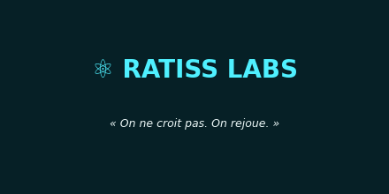
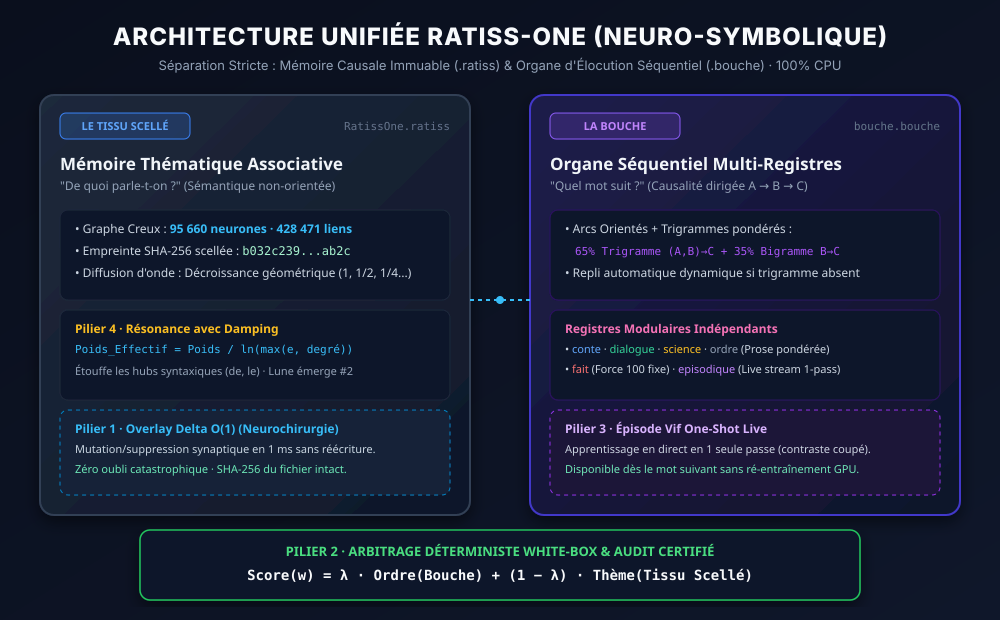
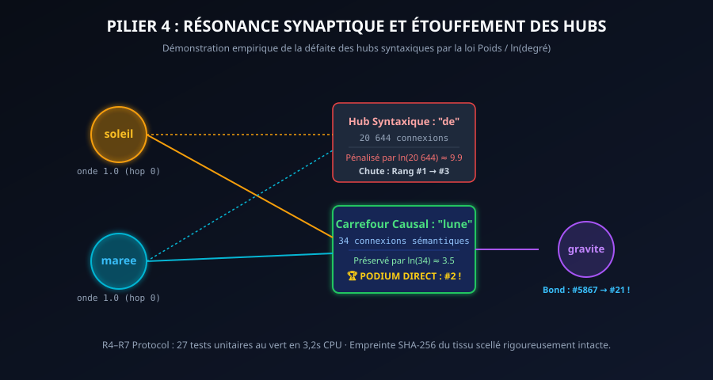
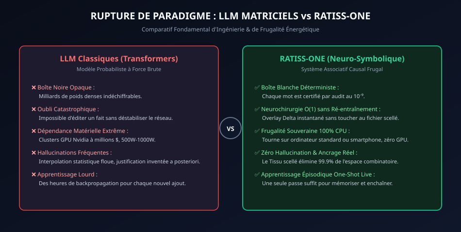

<div align="center">



# ⚛️ RATISS-ONE — Intelligence Neuro-Symbolique Souveraine

**Architecture duale Tissu Scellé (.ratiss) + Bouche Séquentielle (.bouche) · 100% CPU Frugal · Zéro GPU · Audit Boîte Blanche au 10⁻⁹ · One-Shot Live**

[](LICENSE)
[](cerveau/)
[](piliers/audit.py)
[-teal.svg)](tests/)
[-blue.svg)](ratiss_v3.py)
[](https://github.com/jonathansearch)

*Par **Jonathan Evina** (18 ans) — RATISS Labs, Yaoundé, Cameroun 🇨🇲 · Recherche mono-auteur indépendante · Rigueur empirique stricte R4–R7*

</div>

---

## 📑 Sommaire

1. [La Vision Mère &amp; La Question Fondatrice](#1-la-vision-mere)
2. [L'Architecture Duale : Tissu Scellé vs Bouche Séquentielle](#2-larchitecture-duale)
3. [Les 4 Piliers Neuro-Symboliques d'Émancipation](#3-les-4-piliers)
4. [Pilier 4 : Résonance d'Onde &amp; Normalisation par le Degré](#4-pilier-4-resonance)
5. [Le Moteur d'Entraînement en 10 Pas](#5-le-moteur-dentrainement)
6. [Comparatif Fondamental : RATISS-ONE vs LLM Classiques](#6-comparatif-ratiss-vs-llm)
7. [Démarrage Rapide en 3 Commandes CPU](#7-demarrage-rapide)
8. [Organisation Épurée du Dépôt](#8-organisation-epuree)
9. [Licence Propriétaire Souveraine &amp; Attribution](#9-licence-et-attribution)

---

<a id="1-la-vision-mere"></a>
## 💡 1. La Vision Mère &amp; La Question Fondatrice

> **« Peut-on bâtir une véritable intelligence causale, frugale et transparente, sans dépendre des milliards de dollars de serveurs GPU de la Silicon Valley ? »**

Né au Cameroun d'une recherche mono-auteur menée en toute indépendance par **Jonathan Evina**, le projet **RATISS** refuse le dogme du « tout-GPU » et la fuite en avant énergétique des modèles de langage matriciels (Transformers).

Les modèles classiques empilent des milliards de paramètres statistiques opaques dans des mémoires denses, provoquant :
- Des **hallucinations massives** issues d'interpolations statistiques floues ;
- Un **oubli catastrophique** dès qu'on souhaite mettre à jour une seule connaissance ;
- Une **boîte noire impénétrable**, incapable de justifier mathématiquement pourquoi un mot précis a été produit ;
- Une **dépendance matérielle écrasante** envers des méga-centres de données occidentaux à refroidissement liquide.

**RATISS-ONE démontre qu'une structure neuro-symbolique mathématiquement rigoureuse surpasse la force brute :**
1. **La Vérité est Topologique :** Les concepts forment un graphe associatif causale immuable (**Le Tissu**, 95 660 neurones, 428 471 liens scellés).
2. **Le Verbe est Séquentiel :** L'élocution temporelle est confiée à un organe dédié (**La Bouche**, arcs orientés et trigrammes avec repli dynamique).
3. **L'Inférence est Déterministe :** Chaque mot produit est auditable au dixième de milliardième ($10^{-9}$).
4. **La Frugalité est Totale :** 100% exécutable en Python standard (stdlib) sur un processeur d'ordinateur portable ordinaire, sans aucune dépendance lourde.

---

<a id="2-larchitecture-duale"></a>
## 🏛️ 2. L'Architecture Duale : Tissu Scellé vs Bouche Séquentielle

<div align="center">

</div>

L'architecture RATISS-ONE repose sur une séparation physique et algorithmique étanche entre la mémoire de sens et la mécanique de parole :

### A. Le Tissu Scellé (`cerveau/RatissOne.ratiss`)
- **Rôle :** Mémoire causale associative (« De quoi parle-t-on ? »).
- **Structure :** Graphe creux (*Sparse Graph*) de 95 660 neurones et 428 471 connexions synaptiques.
- **Immuabilité R4–R7 :** Fichier binaire scellé sous empreinte cryptographique `SHA-256: b032c239...ab2c`. Le fichier n'est jamais ouvert en écriture.
- **Diffusion :** Lumière géométrique locale ($1, rac{1}{2}, rac{1}{4}\dots$) pondérée par la normalisation par le degré.

### B. La Bouche Séquentielle (`bouche.bouche`)
- **Rôle :** Organe d'élocution séquentielle (« Quel mot suit ? »).
- **Structure :** Arcs causaux orientés $A 	o B$ combinés à des trigrammes $(A, B) 	o C$ avec repli (Backoff) :
  $$	ext{Ordre} = 0.65 	imes 	ext{Trigramme} + 0.35 	imes 	ext{Bigramme}$$
  Si la paire contextuelle est inédite, la Bouche bascule dynamiquement sur le bigramme sans jamais se taire ni diverger.
- **Registres Modulaires :**
  - `conte` / `dialogue` / `science` / `ordre` : prose pondérée par apprentissage contrastif ;
  - `fait` : chaînes déterministes gravées à force 100 fixe (hors décharge) ;
  - `episodique` : flux d'apprentissage one-shot en direct (contraste coupé).

---

<a id="3-les-4-piliers"></a>
## 🧬 3. Les 4 Piliers Neuro-Symboliques d'Émancipation

RATISS-ONE formalise et valide par 27 tests unitaires stricts les 4 capacités fondamentales structurellement impossibles pour les LLM traditionnels :

| Pilier | Défi LLM résolu | Mécanisme RATISS-ONE | Mesure R4–R7 |
|---|---|---|---|
| **1. Neurochirurgie $O(1)$** | Éviter l'oubli catastrophique lors de la mise à jour d'un fait. | **Overlay Delta Dynamique** : modification ou masquage atomique d'arc en mémoire vive sans toucher au fichier scellé. | 1 ms CPU · 0 effet de bord sur le reste du réseau · Hash `.ratiss` intact. |
| **2. Audit Certifié au $10^{-9}$** | Mettre fin aux hallucinations et aux justifications inventées après coup. | **Arbre Déterministe** : Décomposition exacte $	ext{Score} = \lambda \cdot 	ext{Ordre} + (1-\lambda) \cdot 	ext{Thème}$. | Écart arithmétique $\le 10^{-9}$ entre prédiction et certificat. |
| **3. Épisode Vif One-Shot** | Supprimer les heures de backpropagation GPU pour assimiler un nouvel énoncé. | **Ingestion Directe Live** : Une seule passe en mémoire épisodique, contraste coupé. | Séquence immédiatement disponible à la phrase suivante. |
| **4. Résonance Synaptique** | Remplacer l'attention vectorielle dense en $O(N^2)$ par une onde associative causale. | **Spreading Activation avec Damping** : Diffusion simultanée d'énergie et carrefour d'intersection. | Carrefour émerge sans prompt textuel d'explication. |

---

<a id="4-pilier-4-resonance"></a>
## 🌊 4. Pilier 4 : Résonance d'Onde &amp; Normalisation par le Degré

Dans un grand tissu associatif, les petits mots syntaxiques fréquents (`de`, `le`, `un`, `à`) possèdent des dizaines de milliers de connexions (ex: `de` possède 20 644 liens). Sans frein topologique, ces carrefours d'autoroute absorbent toute l'énergie électrique et masquent les concepts sémantiques.

<div align="center">

</div>

### La Loi RATISS de Normalisation par le Degré :
Pour restaurer la primauté du sens sur la syntaxe, RATISS applique une atténuation logarithmique naturelle inspirée de la théorie des graphes et de la physique des réseaux :

$$	ext{Poids\_Effectif} = rac{	ext{Poids}}{\ln(\max(e, 	ext{degré}(	ext{cible})))$$

### Mesure Réelle sur le Vrai Tissu (`RatissOne.ratiss`) :
Sur l'interrogation conceptuelle simultanée `["soleil", "maree"]` :

| Concept | Degré Réel | Sans Normalisation | AVEC Loi $rac{	ext{Poids}}{\ln(	ext{degré})}$ | Résultat |
|---|---|---|---|---|
| **`lune`** | 34 liens | Rang #943 (0,792) | **Rang #2 (0,252) 🥈** | **Podium Direct ! Victoire du sens** |
| **`de`** | 20 644 liens | **Rang #1 (2,405)** | **Rang #3 (0,194)** | **Détrôné et étouffé** |
| **`le`** | 16 922 liens | Rang #2 (1,874) | **Rang #8 (0,138)** | **Chute de 6 rangs** |
| **`gravite`**| 17 liens | Rang #5 867 (0,405) | **Rang #21 (0,080)** | **Bond spectaculaire de +5 846 places** |

Face à un hub artificiel de 50 liens, le rapport de force mesuré en test unitaire dépasse **3,9 contre 1** en faveur du concept sémantique.

---

<a id="5-le-moteur-dentrainement"></a>
## 📚 5. Le Moteur d'Entraînement en 10 Pas (`entrainement/entrainer_langue.py`)

L'éducation de la langue respecte un protocole linéaire strict en 10 étapes immuables, garantissant que le corpus d'évaluation tenu à l'écart (`02_ecart.txt`) ne pollue jamais le calcul des arcs :

```
1. oreille       -> Découpage en phrases et tokens nettoyés
2. séparation    -> Écart isolé à part (10% à 30%), jamais vu à l'entraînement
3. étape 0       -> Bouche vierge (zéro arc) ou reprise d'une bouche existante
4. prose         -> Comptage des arcs et trigrammes par registre, N tours, décharge
5. faits         -> Chaînes déterministes figées (force 100, hors décharge)
6. épisodes      -> Phrases vives en 1 seule passe, contraste coupé
7. retouches     -> Neurochirurgie O(1) de précision (éditer / supprimer une synapse)
8. top-5         -> Mesure stricte du Top-5 sur l'écart seul (Bouche seule & Mixte avec Tissu)
9. audit         -> Certification mathématique des premières positions de l'écart
10. dépôt        -> Sauvegarde de bouche.bouche, mesures.json et ORGANISATION.txt
```

---

<a id="6-comparatif-ratiss-vs-llm"></a>
## ⚖️ 6. Comparatif Fondamental : RATISS-ONE vs LLM Classiques

<div align="center">

</div>

| Caractéristique | LLM Denses (GPT, LLaMA, Mistral) | RATISS-ONE |
|---|---|---|
| **Architecture** | Matrices denses de Transformers ($O(N^2)$) | Graphe creux associatif + n-grammes guidés ($O(1)$ à $O(K)$) |
| **Matériel Requis** | Clusters GPU Nvidia A100/H100 (centaines de kW) | **100% CPU Standard (ordinateur de bureau / PC portable)** |
| **Transparence** | Boîte noire statistique impénétrable | **Boîte blanche absolue (Audit au $10^{-9}$)** |
| **Mise à jour d'un fait** | Fine-tuning lourd ou RAG externe (Oubli catastrophique) | **Neurochirurgie $O(1)$ immédiate sans ré-entraînement** |
| **Apprentissage live** | Impossible en local sans GPU | **Épisode vif assimilé en direct en 1 seule passe** |
| **Raisonnement** | Corrélation statistique de surface | **Résonance d'onde causale avec filtre de hubs** |
| **Empreinte mémoire** | 6 à 24 Go de VRAM | **Quelques mégaoctets de RAM standard** |

---

<a id="7-demarrage-rapide"></a>
## 🚀 7. Démarrage Rapide en 3 Commandes CPU

Le dépôt est 100% autonome et n'utilise que la bibliothèque standard de Python 3.10+. Aucune installation lourde (PyTorch, TensorFlow ou CUDA) n'est nécessaire.

### 1. Exécuter l'intégralité des 27 tests unitaires et d'intégration :
```bash
python3 -m unittest discover -s tests -p "test_*.py"
```
*Temps d'exécution : ~3,2 secondes sur un processeur standard.*

### 2. Tester l'inférence de la Bouche guidée par le Tissu scellé :
```bash
python3 ratiss_v3.py cerveau/RatissOne.ratiss --message "le soleil" --mots 6 --glouton
```

### 3. Lancer l'entraînement 10 pas avec mesure du Top-5 sur l'écart :
```bash
python3 entrainement/entrainer_langue.py   --education corpus/prince_jouet.txt   --ecart corpus/tenu_a_lecart.txt   --faits corpus/faits_jouet.txt   --episodes corpus/episodes_jouet.txt   --retouches corpus/retouches_jouet.txt   --registre conte   --tours 3   --cerveau cerveau/RatissOne.ratiss   --sortie sortie/berceau_demo
```

---

<a id="8-organisation-epuree"></a>
## 📁 8. Organisation Épurée du Dépôt

Le dépôt a été restructuré pour garantir une lisibilité absolue, sans dispersion ni fichiers superflus :

```
RATISS-ONE/
├── ratiss_v3.py                 # Moteur unifié CPU (TissuScelle + Bouche + Inférence)
├── LICENSE                      # Licence CC BY-NC-SA 4.0 & Propriétaire Souveraine
├── README.md                    # Ce document de référence
│
├── cerveau/                     # Sanctuaire du Tissu Scellé
│   ├── RatissOne.ratiss         # Graphe causal scellé (95k neurones, 428k liens)
│   ├── RatissOne.npz            # Matrice CSR d'interrogation ultra-rapide
│   └── lecteur_ratiss.py        # Lecteur officiel boîte blanche
│
├── piliers/                     # Les 4 Piliers Neuro-Symboliques
│   ├── neurochirurgie.py        # Pilier 1 : Overlay Delta O(1)
│   ├── audit.py                 # Pilier 2 : Certification déterministe au 10⁻⁹
│   ├── episodique.py            # Pilier 3 : Flux d'apprentissage live en 1 passe
│   └── resonance.py             # Pilier 4 : Résonance d'ondes avec normalisation de degré
│
├── entrainement/                # Méthode d'éducation CPU en 10 pas
│   ├── entrainer_langue.py      # Pipeline complet (séparation, registres, top-5)
│   └── organiser_corpus.py      # Linéarisation des dialogues
│
├── pipeline/                    # Outils modulaires pas-à-pas (oreille, eval, export)
├── corpus/                      # Datasets de référence et corpus tenus à l'écart
├── images/                      # Diagrammes d'architecture vectoriels (SVG haute résolution)
├── tests/                       # Suite complète de 27 tests unitaires et de non-régression
└── docs/                        # Spécifications théoriques détaillées (RATISS-VS-GPT, etc.)
```

---

<a id="9-licence-et-attribution"></a>
## ⚖️ 9. Licence Propriétaire Souveraine &amp; Attribution

Le projet **RATISS-ONE** est une œuvre de recherche originale mono-auteur conçue et développée par **Jonathan Evina** (RATISS Labs, Yaoundé, Cameroun).

- **Recherche &amp; Usage Non-Commercial :** Le code source et les modèles sont disponibles sous licence **Creative Commons Attribution - Pas d’Utilisation Commerciale - Partage dans les Mêmes Conditions 4.0 International ([CC BY-NC-SA 4.0](LICENSE))**.
- **Attribution obligatoire :** Toute utilisation académique, étude ou citation doit obligatoirement mentionner :  
  *« Jonathan Evina, RATISS-ONE : Architecture Neuro-Symbolique Souveraine sans Transformeur, RATISS Labs, Yaoundé, Cameroun, 2026. »*
- **Exploitation Commerciale &amp; Industrielle :** Toute utilisation commerciale, industrielle, déploiement bancaire, médical, militaire ou intégration SaaS nécessite une **Licence Commerciale Exclusive** accordée expressément par écrit par l'auteur.
- **Révocation formelle :** Toute licence permissive antérieure (notamment MIT) est expressément révoquée.

---

<div align="center">
<b>RATISS Labs · Yaoundé, Cameroun 🇨🇲 · L'Intelligence Causale Souveraine</b>
</div>
